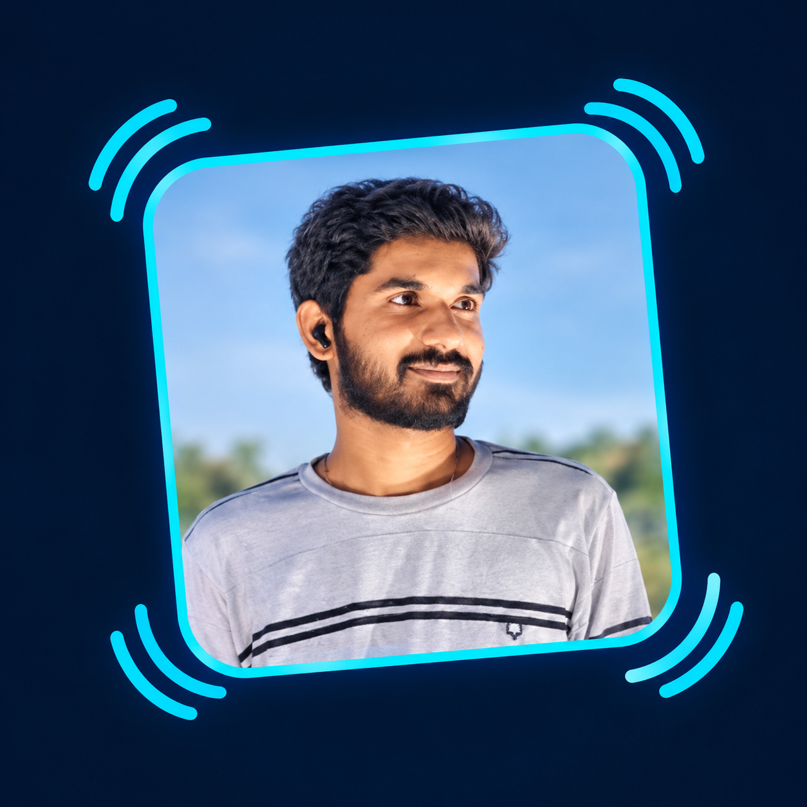

<!-- ======================================================= -->
<!-- RAGHUVARAN RAYA | GITHUB PROFILE README                 -->
<!-- Repository: Raghuvaran45/Raghuvaran45                   -->
<!-- ======================================================= -->

<table>
<tr>
<td width="23%" align="center" valign="middle">

</td>

<td width="77%" valign="middle">

<h1>Hi 👋, I'm Raghuvaran Raya</h1>

<h3>
Computer Science Engineering Student |
Machine Learning |
LLM & RAG Applications
</h3>

</td>

</tr>
</table>

<!-- ======================= ABOUT + SKILLS ======================= -->

<table>
<tr>
<td width="54%" valign="top">

<h2>👤 About Me</h2>

- 🎓 B.Tech in Computer Science and Engineering at VIT-AP University
- 📈 Maintaining a CGPA of **8.93**
- 🤖 Interested in Machine Learning, Deep Learning, RAG, and LLM applications
- 💻 Programming with Java and Python, with experience in SQL-based data analysis
- 🧠 Solved **200+ LeetCode problems**
- 🏆 Participated in the Honeywell Company Hackathon challenge
- 🌱 Continuously learning and building practical technology solutions

</td>
<td width="46%" valign="top">

<h2>🛠️ Technical Skills</h2>

**Programming Languages**

**Machine Learning & AI**

**Data Analysis & Tools**

**Core Computer Science**

- Data Structures and Algorithms
- Object-Oriented Programming
- Database Management Systems
- Operating Systems
- Computer Networks
- Software Engineering

</td>
</tr>
</table>

<!-- ======================= FEATURED PROJECTS ======================= -->

<h2 align="center">🚀 Featured Projects</h2>

<table>
<tr>
<td width="33%" valign="top">

<h3 align="center">1️⃣ Reducing Context Contamination in LLMs</h3>

Built a Retrieval-Augmented Generation (RAG) pipeline that retrieves relevant information from PDF documents and filters irrelevant context before generating grounded answers.

**✨ Key Features**

- Semantic retrieval using BGE embeddings and FAISS
- LLM-based filtering of irrelevant context
- Gemini integration for context validation and answer generation

**🧰 Tech Stack**

Python, FAISS, BGE Embeddings, Gemini LLM, RAG

</td>
<td width="33%" valign="top">

<h3 align="center">2️⃣ Human Emotion Detection</h3>

Developed a CNN-based facial emotion recognition system using deep learning to classify human emotions from facial images.

**✨ Key Features**

- Image preprocessing for facial emotion recognition
- Transfer learning to improve model performance and generalization
- Achieved 95% classification accuracy on benchmark datasets

**🧰 Tech Stack**

Python, OpenCV, TensorFlow, Keras, CNN

</td>
<td width="33%" valign="top">

<h3 align="center">3️⃣ FIFA Database Analysis</h3>

Analyzed FIFA player and team performance data using SQL to extract insights and support data-driven decision-making.

**✨ Key Features**

- SQL joins, aggregations, views, and subqueries
- Player and team performance analysis
- Reports identifying performance trends

**🧰 Tech Stack**

SQL, Database Management, Data Analysis

</td>
</tr>
</table>

<!-- ======================= ACHIEVEMENTS + CERTIFICATIONS ======================= -->

<table>
<tr>
<td width="51%" valign="top">

<h2>🏆 Achievements</h2>

- ⭐ Solved **200+ LeetCode problems**
- ⭐ Maintained an **8.93 CGPA** at VIT-AP University
- ⭐ Secured **97.8%** in Intermediate Board Examinations
- ⭐ Selected to participate in the Honeywell Company Hackathon challenge

</td>
<td width="49%" valign="top">

<h2>📜 Certifications</h2>

- 🏅 AWS Academy Graduate – Cloud Foundations
- 🏅 SQL for Data Science – Great Learning
- 🏅 Supervised Machine Learning: Regression and Classification – Coursera (Stanford Online)

</td>
</tr>
</table>

<!-- ======================= GITHUB STATISTICS ======================= -->

<h2 align="center">📊 GitHub Statistics</h2>

<table>
<tr>
<td width="50%" align="center">

</td>
<td width="50%" align="center">

</td>
</tr>
<tr>
<td colspan="2" align="center">

</td>
</tr>
</table>

<!-- ======================= CONNECT ======================= -->

<table>
<tr>
<td width="65%" valign="top">

<h2>🔗 Connect With Me</h2>

</td>
<td width="35%" align="center" valign="middle">

<h3>💡 My Philosophy</h3>

<i>"Building, learning, and solving problems one project at a time."</i>

</td>
</tr>
</table>

**Thanks for visiting my profile! ⭐**

